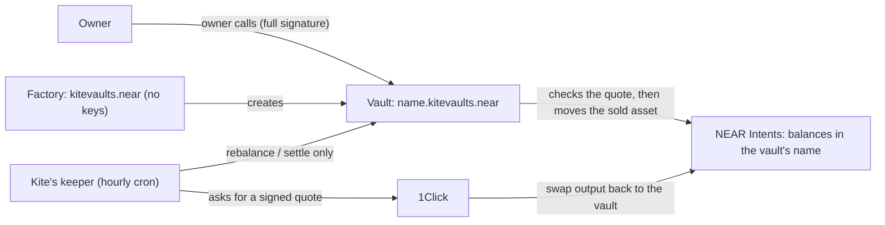

# Kite

**A vault of your own on NEAR that keeps a crypto portfolio on its target mix.** Live at https://www.usekite.xyz, with a [preview mode](https://www.usekite.xyz/console?preview=1) that needs no wallet. Factory `kitevaults.near` on NEAR mainnet. Live vault: [`kite-dao-2.kitevaults.near`](https://nearblocks.io/address/kite-dao-2.kitevaults.near), owned by a DAO and holding gold, Bitcoin and NEAR. Built at NEAR HACKATHON 2026. Tracks: `defi` (main), `social`, `security`. MIT. Demo: [video on X](https://x.com/emmanuel_haanks/status/2120586682714218509).

(Not related to Kite AI or to other hackathon projects named Kite. This one is usekite.xyz and `kitevaults.near`.)

## The problem

A portfolio drifts. Put half in Bitcoin and half in gold, Bitcoin rallies, and most of your money now rides on Bitcoin. Putting it back means watching prices and trading by hand. The tools that do it for you either hold your money in a shared pool, or give a bot a key that can trade anything. A DAO treasury has it worse: every trade needs a vote, so treasuries simply drift.

## What Kite does

Each person or DAO gets a vault: its own NEAR account, `<name>.kitevaults.near`, that only its owner can withdraw from. The owner sets a target mix (up to 8 of 22 assets held in NEAR Intents) and limits. Kite's keeper holds one key on the vault, and NEAR itself limits that key to two methods, `rebalance` and `settle`. The vault accepts a rebalance only if it carries a quote signed by NEAR Intents' 1Click service, and the vault checks that quote on chain before anything moves:

1. 1Click really signed it, less than 5 minutes ago, and it has not been used before.
2. The output and any refund go back to this vault.
3. It sells an asset that is over target by at least the owner's band, and buys one that is under target.
4. It is no larger than the owner's per-trade limit, and does not take the sold asset more than the band below its target.
5. The price is inside the owner's limit, by 1Click's own signed dollar values.

Checks 3 and 4 need a price for every asset in the plan. The two assets being traded are priced from the signed quote. In a plan of three or more assets the others are priced by the keeper, and the vault can only check that those prices are above zero; the tests named `known_limit_…` record what a false price can do there.

Afterwards the vault checks what arrived, and pauses itself if it is short. A DAO votes once on the plan and the limits; after that the vault rebalances inside them with no vote per trade.

**What that buys:** someone who steals Kite's key cannot withdraw, cannot change the plan or the limits, and cannot point a swap's output or refund anywhere but the vault. What they can do is make trades the owner's limits allow, and each one can cost the vault at most about twice the price limit on the amount traded. At the default limits that is about 0.2% of the vault per trade and, for a two-asset plan, 0.8% a day. A thief could collect part of that as a quote fee, because 1Click's signature does not cover app fees. The owner stops it by removing the key: one transaction, or one vote for a DAO (details in [docs/DESIGN.md](docs/DESIGN.md#we-tried-to-rob-our-own-vault)). A model on NEAR AI Cloud can draft a plan and explain each trade in words. It never decides a trade and never touches a key.

**Also in the product:**

- **Earn while you hold.** Done on mainnet (see the claims table). NEAR, ETH, USDC and SOL can each be held as a yield-bearing version inside the same vault: NEAR for staked NEAR (stNEAR, Meta Pool), ETH for wstETH (Lido), USDC for gtUSDC (Morpho), SOL for kSOL (Kamino). The vault treats them like any other asset and rebalances them under the same checks. Live rates: `curl https://www.usekite.xyz/api/yields`.
- **Money in from other chains.** Deposits from Bitcoin, Ethereum, Solana, Base and Arbitrum arrive through NEAR Intents, with no bridge step for the user. To see a live deposit quote: open the preview, **Add money** → **Bitcoin** → **Get a real quote**.
- **Private plan drafting.** Describe what you want in words; a model running in a TEE on NEAR AI Cloud drafts the mix and the limits, and the page verifies the hardware attestation before sending anything.
- **DAO treasuries.** A Sputnik DAO (for example one made in Trezu) creates a vault by proposal and owns it from the first block.

**Where it stands:** live on NEAR mainnet. Anyone can try the whole app without a wallet or funds in preview mode: https://www.usekite.xyz/console?preview=1

## Check it yourself

No wallet, keys or funds are needed for anything in this section.

| Do this | You should see | Needs |
|---|---|---|
| `node scripts/verify.mjs` | A PASS line per claim and a last line `PASS 26 · FAIL 0 · SKIP 0` while the live vault is open (one line fewer for each vault that closes). Checks the wasm hashes, 1Click's signature scheme on a real quote, that the factory has no keys and runs this repository's code, every open vault's code and keys, and 17 mainnet transactions: for each it reads the signer, the signing key and the first action from an archival node and compares them with what this README says. | Node 22.9+. Works before `npm ci`. Offline it prints `SKIP` for the mainnet checks; `--offline` runs only the 3 file checks. Reads public NEAR RPC, nothing else. |
| `npm ci` | Installs the web app, the keeper and the explainer-clip sources (`apps/film`, not part of the product). | npm registry. About 1 minute. |
| `npm test` | Two summaries, both with `fail 0`: web `tests 82`, then keeper `tests 12`. | Nothing. Seconds. |
| `npm run test:contracts` | `test result: ok. 17 passed` (factory) and `test result: ok. 95 passed` (vault). 42 of the vault tests are named `attack_…`: each tries one way to misuse a vault (a stolen keeper key, a stranger's call, a replayed or late quote) and asserts what the vault does. | Rust 1.95+, crates.io. About 2 minutes the first time. |
| `npm run test:integration` | `test result: ok. 8 passed` on a local NEAR node, running the shipped wasm with real keys, and a real SputnikDAO v3.2 that takes over a vault by vote. NEAR Intents has no testnet, so a stand-in contract plays its part in this local test; on mainnet the vault uses the real NEAR Intents. | Rust with `rustup target add wasm32-unknown-unknown`, `cargo-near` 0.22, a 70 MB sandbox download. Linux or Apple-silicon macOS. About 5 minutes the first time. |
| `npm run typecheck && npm run lint && npm run build` | All three finish without errors. | The build downloads fonts from Google. |
| Open https://www.usekite.xyz/console?preview=1 | The whole app on a simulated vault with live prices and real 1Click quotes (`dry: true`). Nothing is signed. To see a rebalance: start a plan, add money, invest, then change the target mix on Guardrails and press **Check now**. | A browser with JavaScript. |
| `curl https://www.usekite.xyz/api/status` | JSON read from the chain at request time: every vault the factory made, which are open, and when each last traded. | — |
| `npm run attack -- --vault kite-dao-2.kitevaults.near` (the live vault; any open vault from `/api/status` works) | Six hostile quotes (two pay or refund `attacker.near`, one is edited, one is signed by the wrong key, one is dry, one buys an asset outside the plan) are handed to the vault's `check_quote` view. Row `Q0`, the honest quote, is accepted; the six are refused, each with its `ERR_…`. Last line: `6 of 6 refused`. | `npm ci`; NEAR RPC and 1Click. It asks 1Click for unfunded quotes that expire unused. No transactions. |

Commands that are not part of checking, because they sign with Kite's keeper key: `npm run attack -- … --send`, `npm run keeper` without `--dry`, `scripts/deploy-factory.sh`, and the `/api/cron` route.

## Claims and how to check each one

| Claim | How to check |
|---|---|
| The factory can't be changed by anyone, us included | `verify.mjs`: `kitevaults.near` has `keys: []`, and its code hash equals `apps/web/public/vault/kite_factory.wasm`. Key deleted in tx `JrAZuKDyaTppVTjjG3eVBCUJw1yFmPDS6g9MfGASTAm`. |
| Every vault runs the code in this repository | `verify.mjs`: the factory's `get_config.vault_code_hash` equals the sha256 of `kite_vault.wasm` (`484f929b…`), and each open vault's code hash matches. The factory embeds that file (`contracts/factory/src/lib.rs`, `VAULT_CODE`). |
| No vault has a full-access key; Kite's key can only call `rebalance` and `settle` on that vault | `verify.mjs` lists each open vault's keys. Sandbox tests show NEAR refusing the key for anything else. |
| The vault verifies 1Click's signature on chain | `contracts/vault/src/lib.rs`, `verify_quote`. Offline: `verify.mjs` runs the same scheme on a real 1Click quote; the unit test `verifies_a_real_1click_signature` in `contracts/vault/src/tests.rs` does it with the contract's own code. |
| A stolen key can't redirect a swap | The 42 `attack_` tests; `npm run attack`; and on mainnet two rebalances signed with Kite's real key that the vault refused: `9vR2bufkfotztJpuP8Rzdm935YkkPBjzPNBL3a6Ri2vR` (`ERR_QUOTE_RECIPIENT`) and `5Q1dQEXK58Jbn3hjteko2sgaMqcrzvJjuSEnDeH5pdcp` (`ERR_QUOTE_SIG`). `verify.mjs` re-reads both. A later full run with the real key, 12 of 12 refused, is in [docs/attack-log.md](docs/attack-log.md). |
| It has rebalanced on mainnet | Tx `EWkADR59cwwnYLspLUAmrjbqQaWKFvWSV79oHJfCc8f7`, signed by the vault's limited key: sold $1.15 of ETH for BTC at 0.33% cost; settled in `4RbnhSFQSBwueYMagQGfKyxvPNg1dgbMm9EeSYtzGP2n`. **Unattended, on the live vault:** after the DAO voted a new mix and, for a vault this small, a larger per-trade limit (proposals 22 and 23), the hourly run at 22:00 UTC on Nov 11, 2026 sold 0.376 NEAR for BTC in [`Ck1NVbN…`](https://nearblocks.io/txns/Ck1NVbN6R12bpr4r4sppsE2MFXb7fMJ6rvNGUPpkukC) and settled it a minute later in [`7BGF6rf…`](https://nearblocks.io/txns/7BGF6rfhjbdW9BQmttAqKM3BQjeiuYJaduRxaRDArQBt). Nobody pressed anything; `/api/status` shows the trade. |
| A vault can hold an earning asset and Kite rebalances it like any other | Vault `emmanuelhaanks-3.kitevaults.near` was invested in Bitcoin and staked NEAR (stNEAR, Meta Pool) in `83cbiXYfN5nR9Dp6St8eFXeLuCvTFHmbtGnxYceW8BR3`. Kite's key then sold 0.375 stNEAR for BTC in `GWapkJTMWKD42BS4gNvsj6g8iaPTkWBQoKJWMrH9othH`, settled in `HuonLqVG1fT1x7XuoKYms6T3RZif64LB8fu918tUWAjk`. `verify.mjs` re-reads both. |
| A DAO can vote on a policy written by NEAR AI, and any voter can re-check it | Proposal 24 on `kite-demo.sputnik-dao.near` sets the live vault's limits and carries a rationale signed by NEAR AI's attested gateway, and a `policy_ref` hash of it. The signature shows NEAR AI produced exactly these words for Kite's exact prompt; it does not show which hardware ran the model. Open https://www.usekite.xyz/verify?dao=kite-demo.sputnik-dao.near&id=24: every check reads **Verified** in the browser, with no wallet (signature, the gateway's TEE report, Kite's exact prompt, the vault's owner, the calls, the worst case). The page checks against NEAR AI's current report, so it reads Verified for as long as NEAR AI keeps the gateway key that signed it. Approved in `B4wdWx2vVuYdQZj4wQ9MyFcwFBUGeirZ7iVHtkGqtn3y`. |
| A DAO can own and run a vault by vote | Proposals 0 to 25 on `kite-demo.sputnik-dao.near`. The live vault `kite-dao-2.kitevaults.near` was created by proposal 19 ([`7Q7Ar2E…`](https://nearblocks.io/txns/7Q7Ar2Em6acP3iZmKEwFKrUABG3fo2nHSbsGR148BwuN)), funded with 5 USDC by proposal 20 and invested in gold, Bitcoin and NEAR by proposal 21 ([`A6HuJFg…`](https://nearblocks.io/txns/A6HuJFgJcBC9nbgM7Dza2KUWECCWkXgkD9e3q8H5Dppk)). Proposals 22 and 23 then changed its rules and its target mix by vote, and Kite traded it to the new mix at its next hourly run. Three earlier DAO vaults were created, funded and closed the same way (proposals 0 to 11 and 15 to 18). It is our demo DAO, made in Trezu. It had one member for proposals 0 to 24; proposal 25 added a second, `saintsda.near`. A vote on the vault passes with one approval. The sandbox test runs the same flow against SputnikDAO v3.2's own code. |
| The shipped wasm is built from this source | With exactly Rust 1.97.0 and cargo-near 0.22.0, the command in [docs/DESIGN.md](docs/DESIGN.md#repository) rebuilds both files byte for byte (checked on macOS arm64). |

## What you trust

- **1Click's signing key** (`ed25519:reYaWhvwu8Jzo3WUM3zhn6VrhuMEF4eADL17qtRVifc`), for a quote's terms and its dollar values. The owner can rotate it.
- **Kite's keeper, for showing up.** If it stops, nothing is traded and nothing is lost. The owner can withdraw without it (`withdraw`), and can hand the same limited role to any other keeper (`set_agent`). The keeper is in `packages/keeper`.
- **NEAR AI, for words only.** Numbers shown to users are computed by code.

## How NEAR is used

- **NEAR Intents** holds every asset as a balance owned by the vault account, and its **1Click** service prices and executes every swap and deposit from other chains.
- **Function-call access keys** limit Kite's key at the protocol level: two methods, one contract, no deposits, 0.25 NEAR of gas.
- **Named sub-accounts** from an ownerless factory: one contract account per vault.
- **Sputnik DAO and Trezu**: a DAO creates and owns a vault by proposal.
- **NEAR AI Cloud**: plan drafting and trade explanations on attested hardware, and signed policy rationales a DAO voter can re-check at `/verify`.

- **Chain abstraction**: BTC, ETH, SOL, XRP, DOGE, ZEC, gold and dollars from other chains are held and traded from one NEAR account, and deposits arrive from those chains without the user bridging.
- **Meta Pool liquid staking** (stNEAR) as an earning asset inside the vault.

## Where to look

| | |
|---|---|
| The checks | `contracts/vault/src/lib.rs`: `rebalance`, `verify_quote`, `policy_check`, `settle` |
| The attacks | `contracts/vault/src/tests.rs` (`attack_…`, `known_limit_…`), `packages/keeper/scripts/attack.ts` |
| The factory | `contracts/factory/src/lib.rs` |
| The keeper | `packages/keeper/src/run.ts` (one check of one vault), `oneclick.ts`, `near.ts` |
| The hourly run | `apps/web/src/app/api/cron/route.ts`, `apps/web/vercel.json` |
| What the browser checks before you sign | `apps/web/src/lib/near/allocate-check.ts` |
| Sandbox tests | `contracts/integration-tests/tests/sandbox.rs` |

## After the hackathon

First users: DAO treasuries on Sputnik and Trezu, where one vote on a mandate replaces a vote per trade; then individuals. Next vault version: a tighter loss bound for plans with three or more assets, a balance check on close and reproducible-build metadata, then an external audit before larger amounts. Keepers: anyone can run one, since a vault's owner picks the key; we would run the default. Paying for it: a small, disclosed keeper fee per rebalance, which the vault's price limit already caps.

## Hackathon disclosure

- **Build window.** Work started on Nov 2, 2026 and was first committed on Nov 3. Nothing was written before the hackathon.
- **History.** The history was rewritten on Nov 10 and 11, 2026, around the time the repository became public: private working notes were removed, and documentation and commit messages were edited. No code was changed by it apart from one comment in a test file, and commit dates are as they were.
- **Third-party code, tools and data.** near-sdk, near-workspaces, near-api-js, NEAR Wallet Selector, `@nearai/inference-sdk`, Next.js, Tailwind, Radix, Remotion. Built with AI coding tools, as the rules allow (Q-005). `contracts/integration-tests/res/sputnikdao2_v3_2.wasm` is SputnikDAO's own contract, fetched from mainnet for the sandbox tests. Prices and history from 1Click, NearBlocks, Kraken and CoinGecko; yields from Meta Pool, Lido, Morpho and Kamino. Media credits are in [docs/DESIGN.md](docs/DESIGN.md#credits-and-notes).
- **Other entries.** This team has no other project in NEAR HACKATHON.

Kite is not financial advice.
